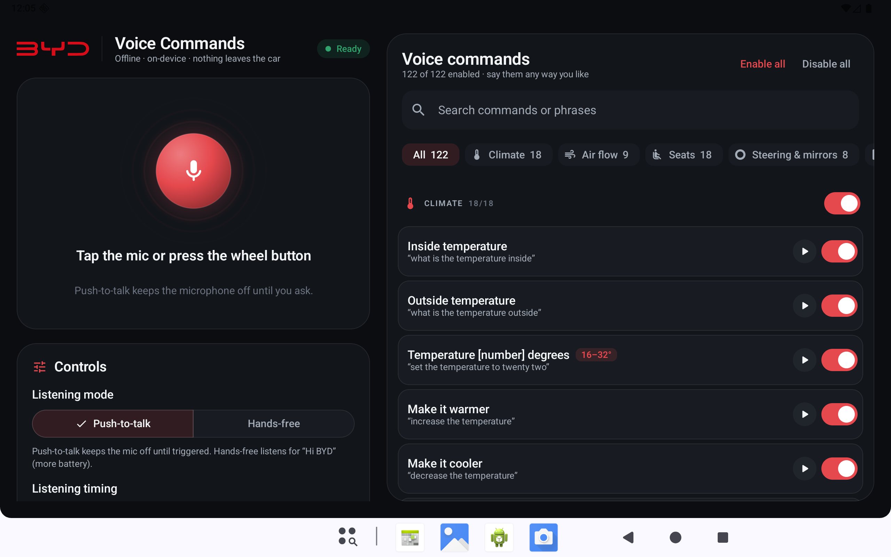
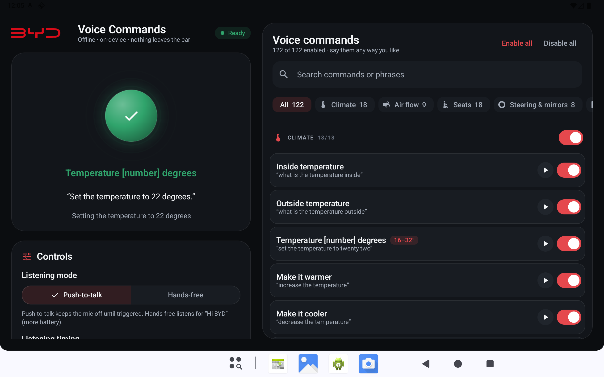
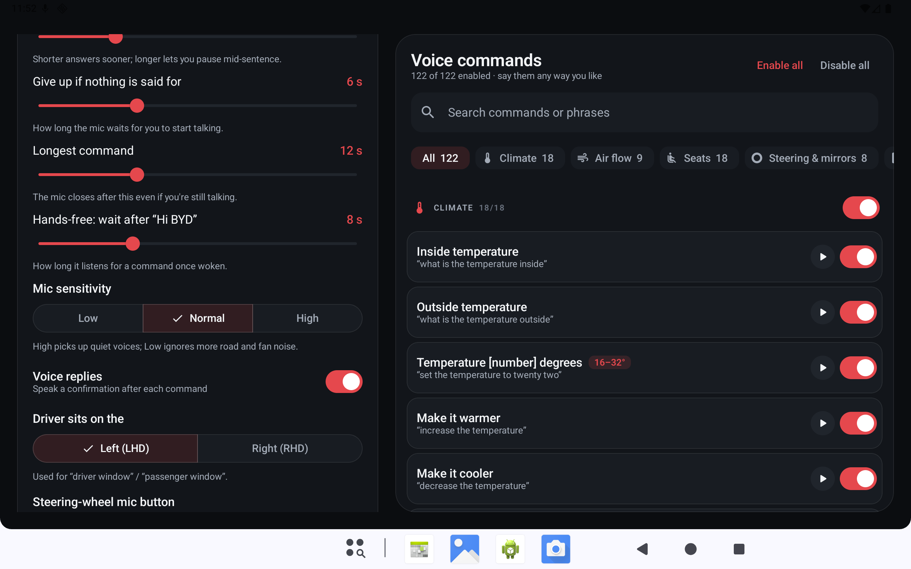

# BYD Voice Commands

An offline voice assistant for BYD cars with the DiLink Android head unit. Press the steering-wheel
voice button, say what you want in your own words ("make it a bit warmer", "open the rear right
window thirty percent", "Hi BYD, show me the rear camera"), and the app does it through the car's
own vehicle API, then tells you what it did.

Everything runs on the head unit. There is no server, no account, and no internet permission:
your voice never leaves the car.

<p align="center">
  
</p>

## Features

- **122 commands** across climate, air flow, seats, steering wheel and mirrors, doors and trunk,
  windows, sun shade and roof, lights, cameras, driving modes and the screen, plus
  "open ‹any installed app›".
- **Say it your way.** Commands are matched by meaning, not by exact phrases, and survive common
  mishearings ("hazzard", "Fanspeed for", "head of display").
- **Numbers and values**: temperatures (with °C/°F conversion), fan levels, window and roof
  percentages, halves and quarters, light colours, app names.
- **Live transcript and spoken replies**: an overlay shows what you're saying as you say it and
  the result; text-to-speech confirms the action ("Setting the temperature to 22 degrees").
- **Push-to-talk by default**, triggered by the steering-wheel button, the app or the
  notification. The microphone stays off between commands. Optional hands-free mode listens for
  "Hi BYD" / "Hello BYD".
- **Pick your commands**: turn any command or whole category on or off, with search.
- **Tune the listening**: how long a pause ends a command, how long to wait for you to start, the
  longest command, how long hands-free stays awake after "Hi BYD", and mic sensitivity.
- **Small**: the whole app, speech model included, is about 57 MB.

| Command done | Settings |
|---|---|
|  |  |

## How it works

```
steering-wheel button ─▶ mic ─▶ Moonshine Tiny (on-device speech-to-text)
                                   │ live text ─▶ overlay
                                   ▼ final text (one pass over the whole command)
                            command matcher ─▶ vehicle API (android.hardware.bydauto.*) ─▶ spoken reply
```

1. **Speech to text.** [Moonshine](https://github.com/moonshine-ai/moonshine) Tiny streaming
   (34M parameters, MIT licence) runs through ONNX Runtime on the head unit's CPU. It streams text
   while you speak; when you pause, the whole command is transcribed again in one pass, which gives
   the same text for the same audio and is slightly more accurate. The decoder is nudged towards a
   short dictionary of car terms ("ventilation", "recirculation", "hazard lights", "BYD"…).
2. **Understanding.** The transcript is normalised (numbers, units, "30%"), then words are mapped
   to concepts through a synonym lexicon with multi-word phrases, glued-word repair ("sunroof",
   "fanspeed") and fuzzy, sound-alike matching for mishearings. Each command declares the concept
   groups it needs and the ones that rule it out, so on/off, open/close and driver/passenger can't
   be confused. The best-scoring command wins, if it is confident enough.
3. **Acting.** Commands call the head unit's vehicle framework (`AcDevice`, `BodyworkDevice`,
   `SettingDevice`, `EnergyDevice`, …) with the argument values documented in
   [docs/BYD_API_MAPPING.md](docs/BYD_API_MAPPING.md). Window and roof percentages start the
   motor, watch the reported position and stop it at the target.

### Numbers and other values

| You say | The app does |
|---|---|
| "set the temperature to twenty two point five" | sets 22.5° (converted if the car uses °F) |
| "make it warmer by two" | raises the set-point by 2° |
| "fan speed four" / "fan speed for" | fan level 4 |
| "open the driver window thirty percent" | moves the window to 30 % |
| "open the roof halfway / a quarter / three quarters" | 50 / 25 / 75 % |
| "strong passenger ventilation" | seat ventilation, high |
| "set the ambient light to blue" | ambient colour blue |
| "open spotify" | launches the installed app whose name sounds closest |

### Accuracy

Measured with `tools/asr_bench.py` on 96 spoken commands (8 synthetic voices including Indian,
Irish and Australian English), scored by whether the right command and values would fire:

| Audio | Correct |
|---|---|
| clean | ~86 % |
| moderate road noise (15 dB SNR) | ~80 % |
| heavy noise and a cheap mic (5 dB SNR, 300–3400 Hz) | ~47 % |

Synthetic voices aren't real drivers, so treat these as a regression baseline rather than a
promise.

## Commands

| Category | # | Commands |
|---|---|---|
| Climate | 18 | Inside temperature, Outside temperature, Temperature [number] degrees, Make it warmer, Make it cooler, Fan speed [number], Increase fan speed, Decrease fan speed, Turn on fan, Turn off fan, Turn on windshield fan, Turn off windshield fan, Turn on air conditioner, Turn off air conditioner, Turn on cabin ventilation, Turn off cabin ventilation, Turn on air conditioner auto mode, Turn off air conditioner auto mode |
| Air flow | 9 | Air to face, Air to feet, Air to windshield, Air to feet and face, Air to feet and windshield, Air to face and windshield, Air to all directions, Air recirculation, Outside air |
| Seats | 18 | Turn on driver heating, Strong driver heating, Turn off driver heating, Turn on passenger heating, Strong passenger heating, Turn off passenger heating, Turn on seats heating, Strong seats heating, Turn off seats heating, Turn on driver ventilation, Strong driver ventilation, Turn off driver ventilation, Turn on passenger ventilation, Strong passenger ventilation, Turn off passenger ventilation, Turn on seats ventilation, Strong seats ventilation, Turn off seats ventilation |
| Steering & mirrors | 8 | Turn on steering wheel heating, Turn off steering wheel heating, Turn on mirror heating, Turn off mirror heating, Fold mirrors, Unfold mirrors, Fold the mirrors now, Unfold the mirrors now |
| Doors & trunk | 5 | Close doors, Open doors, Open trunk, Partially open trunk, Close trunk |
| Windows | 20 | Open all windows, Close all windows, Open all windows halfway, Ventilate cabin, Open driver window, Close driver window, Open driver window halfway, Open driver window a quarter, Open passenger window, Close passenger window, Open passenger window halfway, Open passenger window a quarter, Open rear left window, Close rear left window, Open rear left window halfway, Open rear left window a quarter, Open rear right window, Close rear right window, Open rear right window halfway, Open rear right window a quarter |
| Curtain & roof | 8 | Open sun shade, Partially open sun shade, Close sun shade, Open roof, Open roof a quarter, Open roof halfway, Open roof fully, Close roof |
| Lights | 12 | Turn on lights, Turn off lights, Ambient color [color], Turn on ambient lighting, Turn off ambient lighting, Turn on daytime running lights, Turn off daytime running lights, Turn on auto high beams, Turn off auto high beams, Turn on hazard lights, Turn off hazard lights, Say thank you |
| Cameras | 4 | View from left, View from right, View from rear, View from front |
| Driving | 10 | Normal mode, ECO mode, Sport mode, Snow mode, Strong energy recovery, Weak energy recovery, Regular steering wheel, Sport steering wheel, Raise wipers, Lower wipers |
| Screen | 9 | Turn on screen, Turn off screen, Split screen, Daytime screen brightness, Night screen brightness, Light theme, Dark theme, Turn on head up display, Turn off head up display |
| Apps | 1 | Open [app name] |

Each one can be phrased many ways; the app shows example phrases and lets you try any command
without speaking.

**Not confirmed on a car yet:** lock/unlock, folding the mirrors now, raising the wipers, ambient
colour, inside temperature and opening the trunk partway. These use vehicle-API feature IDs that
the app looks up by name on the car's firmware; check them with
`adb logcat -s FeatureIds BydController` before relying on them.
**Need an extra permission:** split screen (the button service in Accessibility settings), screen
brightness ("Modify system settings"), light/dark theme (a system permission on most units).

## Install on the car

You only need this app: it talks to the car's vehicle API directly, so diplus or any other helper
app isn't required.

1. On the head unit, turn on developer options and ADB (USB or wireless; how depends on the model
   and firmware). From your computer:
   ```bash
   adb connect <head-unit-ip>:5555        # wireless ADB only
   adb install -r app-car-release.apk
   ```
2. Open **BYD Voice Commands** and tap **Allow** on every prompt: microphone, notifications and
   the car's own permission prompts (the vehicle-control permissions, `BYDAUTO_*_COMMON`). Without
   those the car refuses every command, and the app now says so and shows **Car controls off**.
3. Under **Permissions**, also allow Show over apps and Stay running.
4. Turn on the button service (Accessibility), tap **Learn button** and press the steering-wheel
   voice button. The press is consumed, so the built-in assistant stays quiet.
5. Test with the ▶ button next to any command, then with your voice.

### If commands still don't work

```bash
adb logcat -s CarPermissions BydController VoiceService
```

`CarPermissions` lists every vehicle permission, whether the car treats it as a runtime permission
and whether it's granted; `BydController` logs each call and the exact error. If a prompt was
dismissed for good, tap **Car controls** under Permissions (it opens the app's permission page), or
grant them over ADB:

```bash
for p in $(adb shell dumpsys package com.offline.bydvoice | grep -o 'android.permission.BYDAUTO_[A-Z_]*' | sort -u); do
  adb shell pm grant com.offline.bydvoice $p 2>/dev/null && echo "granted $p"
done
```

## Build

Requirements: JDK 17 and the Android SDK (platform 34).

```bash
./gradlew :voicecore:test           # command-matching tests (plain JVM, seconds)
./gradlew :app:assembleCarRelease   # app/build/outputs/apk/car/release/app-car-release.apk
```

The release build is shrunk with R8 and signed with the debug key so it can be sideloaded. The
Moonshine model is bundled in `app/src/main/assets/moonshine/tiny-streaming-en/` and copied to
app storage on first launch.

## Testing without a car

The **mock** flavor bundles a stand-in for the vehicle API that sends every call to a companion
**BYD Mock Service** app (`recorder/`), which lists them, and simulates the window and roof motors.
The recorder also defines the car's `BYDAUTO_*_COMMON` runtime permissions, so the emulator refuses
commands until they're allowed, like a real head unit. Install the recorder first.

```bash
./gradlew :app:assembleMockDebug :recorder:assembleDebug
adb install -r app/build/outputs/apk/mock/debug/app-mock-debug.apk
adb install -r recorder/build/outputs/apk/debug/recorder-debug.apk
```

With the app in the foreground, drive it from adb:

```bash
R=com.offline.bydvoice.mock/com.offline.bydvoice.testhook.RunCommandReceiver
F=/sdcard/Android/data/com.offline.bydvoice.mock/files
adb shell am broadcast -n $R --es text "'open the sunroof halfway'"   # text straight to the matcher (note the inner quotes)
adb shell am broadcast -n $R --es audio $F/cmd.wav                  # a 16 kHz mono WAV through the mic pipeline
adb shell am broadcast -n $R --es audio $F/hi.wav --ez wake true    # the same, through hands-free standby
adb shell am broadcast -n $R --es id ALL                            # every command once
```

On a Mac, start the emulator from Terminal (`tools/run-emulator.command`) so macOS can grant it the
microphone. The stock emulator image has no text-to-speech engine, so replies are shown but silent.

To measure recognition after a change:

```bash
pip install moonshine-voice numpy
python tools/asr_bench.py /tmp/bench                                  # macOS: uses `say`
./gradlew :voicecore:nluEval --args="score /tmp/bench/results.tsv"
./gradlew :voicecore:nluEval --args="explain 'Fanspeed for.'"         # how one transcript is read
```

## Project layout

| Module | Contents |
|---|---|
| `app` | The Android app: speech engine, overlay, Compose UI, vehicle controller. Flavors `car` and `mock`. |
| `voicecore` | Pure Kotlin: lexicon, number parsing, fuzzy matching, command catalog, matcher, wake word, tests. |
| `bydstub` | Compile-only stubs of `android.hardware.bydauto.*`; the real classes come from the car's firmware. |
| `bydmockimpl` | The mock vehicle API used by the `mock` flavor. |
| `recorder` | The BYD Mock Service app that shows the calls the mock receives. |
| `tools` | Recognition benchmark and the emulator launcher. |

## Credits

- Speech recognition: [Moonshine](https://github.com/moonshine-ai/moonshine) by Moonshine AI
  (MIT), running on [ONNX Runtime](https://onnxruntime.ai) (MIT).
- The BYD logo is a trademark of BYD Company Ltd. The vector used here comes from
  [Wikimedia Commons](https://commons.wikimedia.org/wiki/File:BYD_Auto_2022_logo.svg).

This is an independent project, not affiliated with or endorsed by BYD. It talks to vehicle
systems; use it at your own risk and never in a way that distracts you from driving.
